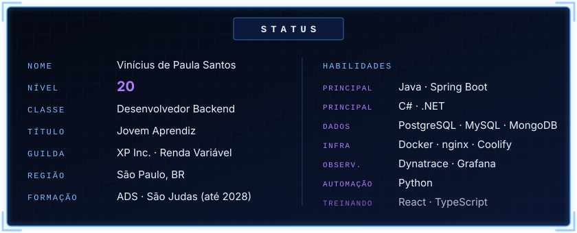
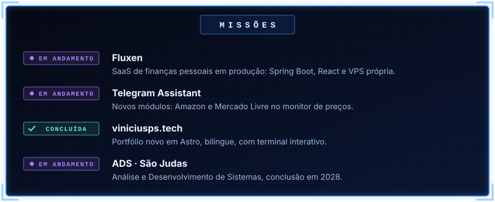

Desenvolvedor backend em São Paulo. Java e Spring Boot nos meus projetos, C# e .NET na XP Inc.

 

<picture>
  <source media="(prefers-color-scheme: dark)" srcset="assets/generated/snake-dark.svg">
  <source media="(prefers-color-scheme: light)" srcset="assets/generated/snake-light.svg">
  
</picture>
